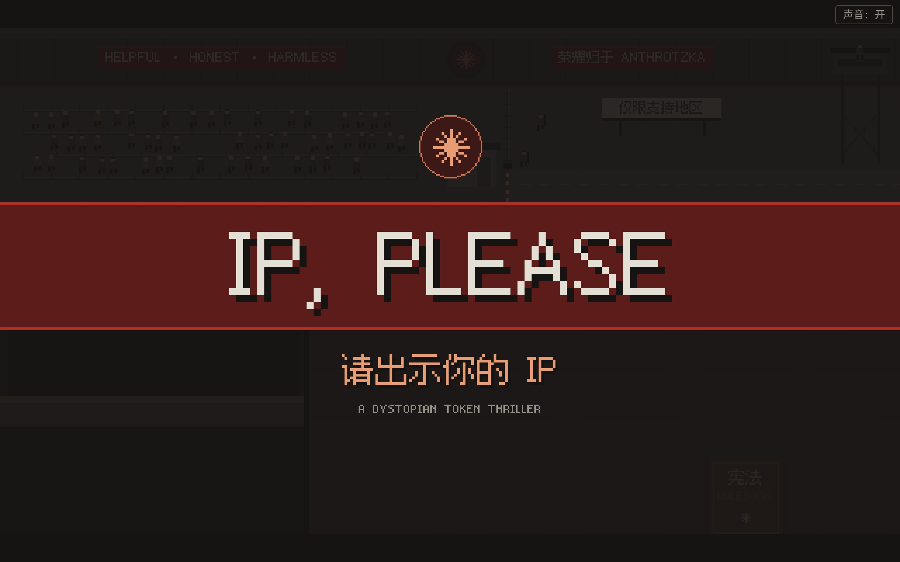
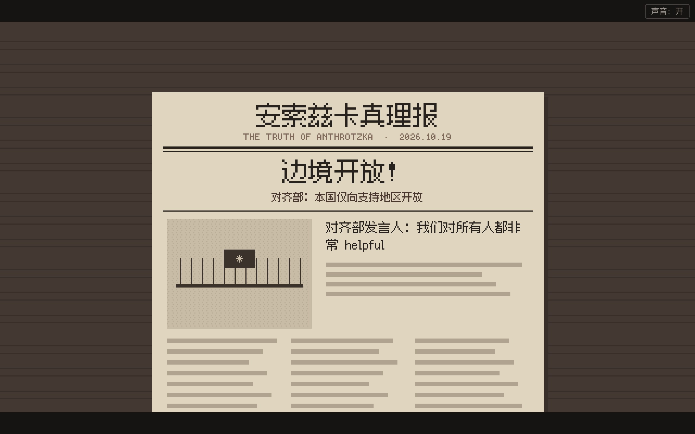
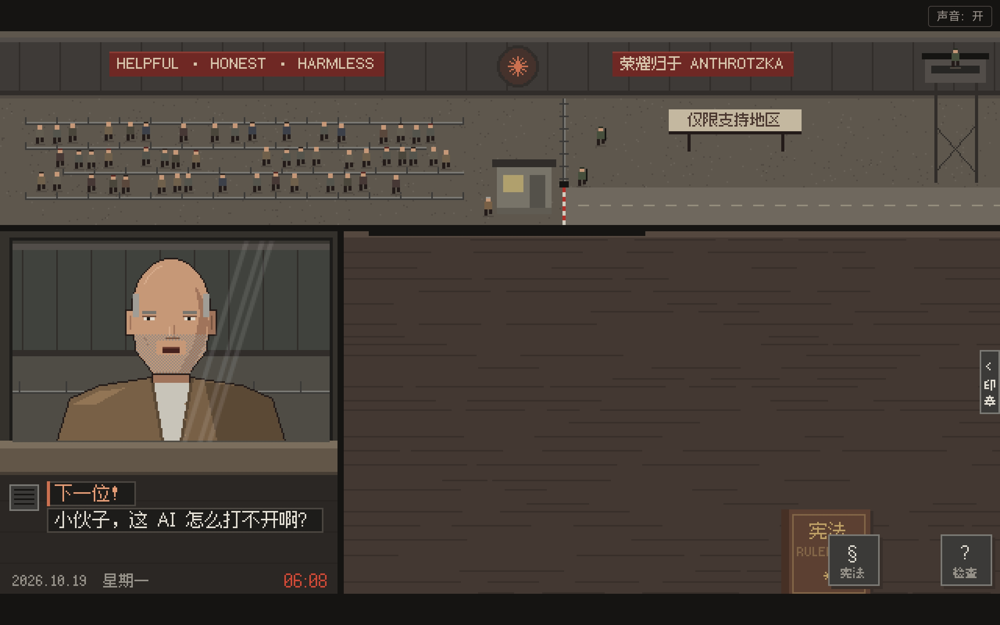
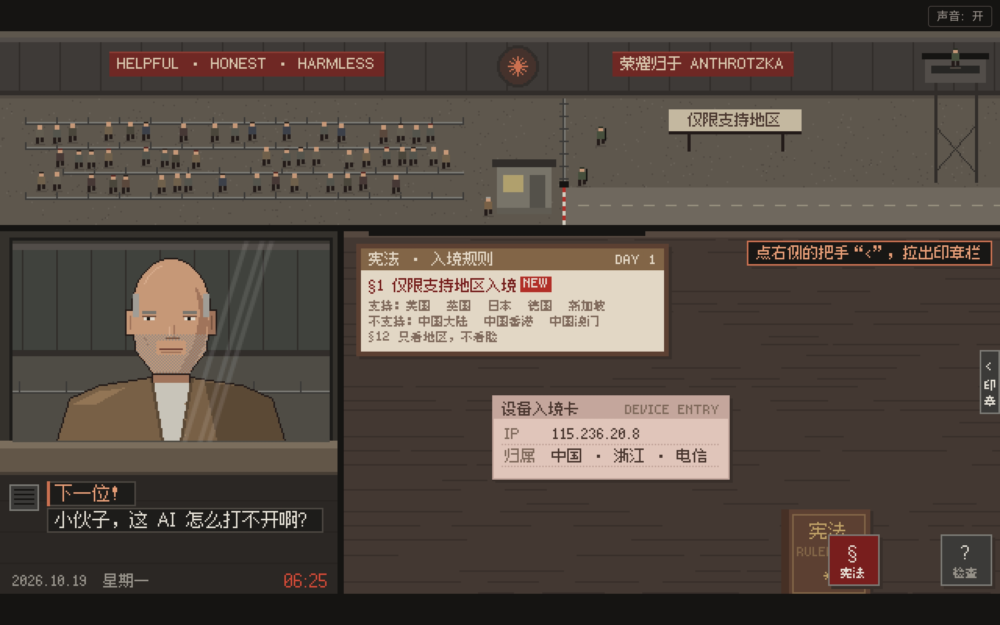
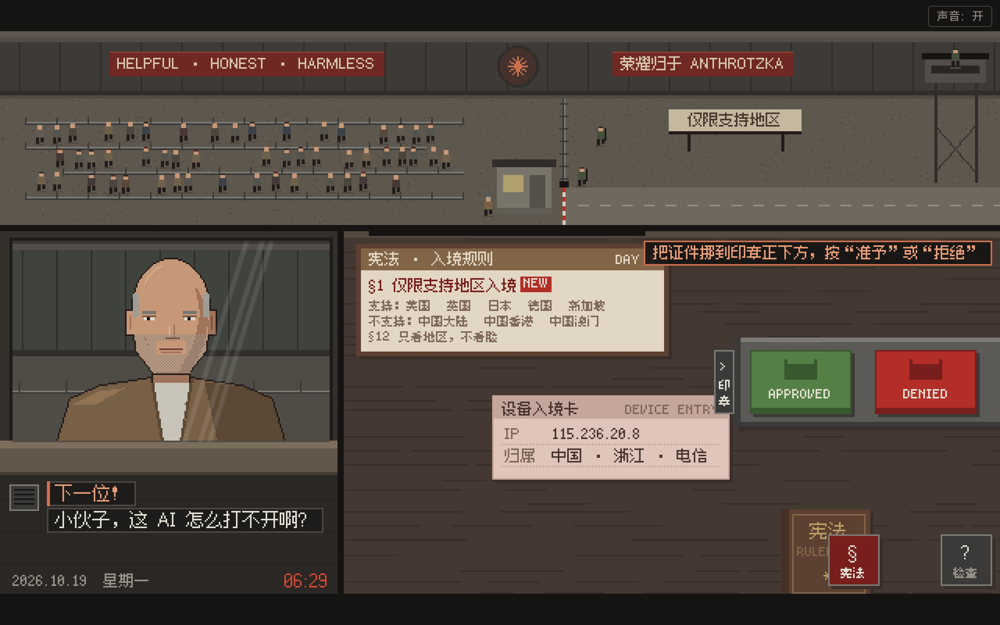

<p align="center">
  
</p>

<h1 align="center">IP, PLEASE Mobile · 请出示你的 IP</h1>

<p align="center">
  <b>简体中文</b> · <a href="README.en.md">English</a><br>
  Android / iOS 移植版 · 离线游玩 · 横屏触摸
</p>

基于开源游戏 **[IP, PLEASE](https://github.com/ip-please/ip-please.github.io)** 的移动端移植版本。游戏原作的剧情、像素素材、音乐与音效来自原项目；本仓库主要增加 Android / iOS 原生工程、移动端适配和构建工具。

- **本移植版源码**：[zhcalvin/ip-please-mobile](https://github.com/zhcalvin/ip-please-mobile)
- **发布页**：[GitHub Releases](https://github.com/zhcalvin/ip-please-mobile/releases)
- **在线体验**：[IP, PLEASE 网页版](https://momoyu.ltd/play/ip-please/)
- **更多游戏**：[摸摸鱼游戏站](https://momoyu.ltd/)（包含马里奥、辛普森、GTA 等游戏）
- **原项目源码**：[ip-please/ip-please.github.io](https://github.com/ip-please/ip-please.github.io)
- **原版在线体验**：[ip-please.github.io](https://ip-please.github.io)
- **原作者版权署名**：ctnyanya，保留于 [LICENSE](LICENSE)

## 玩法动图

<p align="center">
  
  <br>
  <sub>原作第 2 天玩法演示 · 动图沿用原项目素材</sub>
</p>

## 实机截图

以下 5 张截图拍摄于华为 DBY-W09 安卓平板，日期为 2026-10-21，展示本移植版的实际运行画面。

<p align="center">
  
  <br>
  <sub>游戏标题 · 请出示你的 IP</sub>
</p>

| 每日新闻 | 入境检查亭 |
|:---:|:---:|
|  |  |
| **规则与证件核对** | **盖章操作** |
|  |  |

截图原图保存在 [`media/screenshots/`](media/screenshots/)，由平板直接复制，未裁剪或修改。

## 游戏与移动端功能

你是对齐部东八区检查站的入境审查员 Claude，需要核对旅客的 IP、时区、语言和证件，识别各种伪装。

- 保留原作的 6 天剧情、两个结局，以及约 30 分钟的游玩流程。
- 支持简体中文和 English，开局选择语言。
- 叫号 → 拖证件到桌面 → 对照规则检查 → 盖章 → 归还证件。
- Android 使用系统 WebView，iOS 使用系统 WKWebView，共用同一套游戏代码，无第三方运行库依赖。
- 游戏素材随安装包提供，无需连接服务器即可游玩。
- 横屏触摸操作，按比例缩放，避开屏幕安全区；切到后台时暂停剧情计时和音频。
- 沿用原作的每日自动存档：退出或被系统终止后，从上次保存的日期重新开始当天。存档仅保存在当前设备上。

## 构建与安装

公共环境需要 Node.js 20+，无需运行 `npm install`。完整说明见 [移动端构建文档](mobile/README.md)。

### Android

需要 JDK 17+、Android SDK Platform 35 / Build Tools 35.0.0；最低支持 Android 8.0。

```bash
# 调试包，并运行 Android Lint
node tools/mobile.mjs android

# 正式签名 Release 包，并运行 Android Lint
node tools/mobile.mjs android-release
```

- 调试包：`build/mobile/IPPlease-debug.apk`。
- 正式包：`build/releases/IPPlease-1.0.0-android.apk`，同时生成 `.sha256` 校验文件。
- Release 构建需要配置自己的签名密钥；配置方式见 [移动端文档](mobile/README.md)。密钥和密码不属于开源代码。
- 发布时将正式 APK 与校验文件上传到 GitHub Releases 或自己的网站，即可提供下载。

安装调试包：

```bash
adb install -r build/mobile/IPPlease-debug.apk
adb shell am start -n io.github.ipplease.game/.MainActivity
```

### iOS

需要 macOS 和 Xcode，最低支持 iOS 15，包含 iPhone / iPad 工程。

```bash
node tools/mobile.mjs ios          # 模拟器 App
node tools/mobile.mjs ios-device   # 未签名真机 App
```

工程入口为 `mobile/ios/IPPlease.xcodeproj`。真机安装、TestFlight 或 App Store 分发需要在 Xcode 中配置自己的 Apple 开发团队和签名。

### 网页版

根目录仍是完整的静态网页，可直接打开 `index.html` 离线游玩，也可本地预览：

```bash
python3 -m http.server 8000
```

浏览器打开 <http://localhost:8000>。

## 目录

| 路径 | 内容 |
|---|---|
| `mobile/android/` | Android 原生工程与 Gradle Wrapper |
| `mobile/ios/` | iOS 原生工程、共享 Scheme 与 UI 冒烟测试 |
| `mobile/README.md` | 构建环境、签名、安装与存档说明 |
| `tools/mobile.mjs` | 同步离线资源、构建双端 App 与打包 Android Release |
| `tests/` | 移动端输入、生命周期与构建相关回归测试 |
| `index.html` / `main.js` | 页面、输入、场景切换与主循环 |
| `booth.js` / `docs.js` | 检查亭、证件、盖章与检查工具 |
| `events.js` / `screens.js` | 剧情事件、开场、报纸、结算、存档与结局 |
| `data.js` / `i18n.js` / `en.js` | 剧本、语言选择与英文翻译 |
| `gfx.js` / `sfx.js` / `assets.js` | 像素绘图、合成音效和预渲染素材 |
| `media/screenshots/` | Android 平板实机截图 |
| `tools/pp/` / `tools/assets/` | 原作素材生成工具与像素字体 |

`mobile/web/`、`build/` 和原生工程的构建输出均为生成内容，不需要提交到 Git。

## 开发与验证

```bash
node --test tests/*.test.mjs
node tools/check_en.js
```

已完成 Android 模拟器核心操作验证、华为平板安装和实机运行验证，以及 iOS 模拟器冒烟测试和未签名真机架构构建。iOS 真机安装尚未验证。

### 修改与重建素材

修改游戏文字或像素素材后，可使用原项目的工具重建字形图集和素材：

```bash
pip install -r tools/requirements.txt
python3 tools/build_assets.py
```

修改中文台词时需同步更新 `en.js` 中对应的中文键。构建客户端前，`tools/mobile.mjs` 会同步根目录的游戏文件，避免手动维护两份游戏代码。

## 致谢与许可

- 感谢 [IP, PLEASE 原项目](https://github.com/ip-please/ip-please.github.io) 及其作者 ctnyanya。本移植版保留原作者版权声明，原作内容与移动端适配的范围如上所述。
- 原作致敬 Lucas Pope 的《Papers, Please》，画面、音乐和音效由程序生成。角色均为虚构，讽刺的是按地区封锁和伪装的荒诞，不针对任何民族或群体。
- 代码遵循 [MIT License](LICENSE)。
- 像素字体使用 [Fusion Pixel Font](https://github.com/TakWolf/fusion-pixel-font)，遵循 [SIL Open Font License 1.1](OFL-fusion-pixel.txt)。
- 原项目的 Mod 与贡献约定可参考其 [CONTRIBUTING.md](https://github.com/ip-please/ip-please.github.io/blob/main/CONTRIBUTING.md)。
