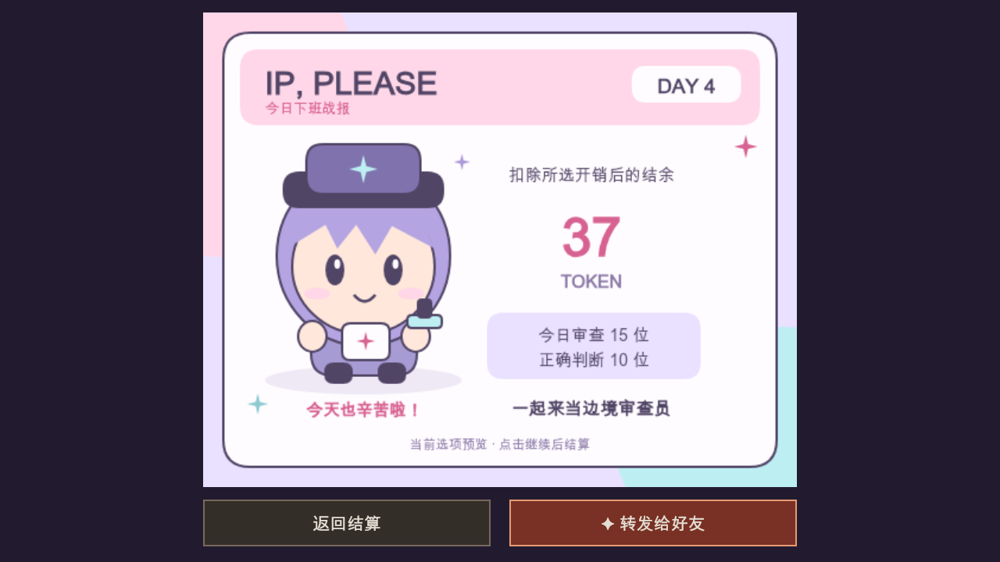

# IP, PLEASE 微信小游戏

基于 [IP, PLEASE 原项目](https://github.com/ip-please/ip-please.github.io) 的独立微信小游戏工程，与 Android / iOS 工程共用仓库根目录的剧情和规则。客户端使用微信原生 Canvas 2D，保留六天剧情、询问、测谎、拘留和两种结局，不嵌套网页。当前不接入广告。

## 构建与导入

本地构建需要 Node.js 20+，无需 `npm install`。在仓库根目录运行：

```bash
node wechat/tools/build.mjs
```

然后用微信开发者工具导入 `wechat/minigame/`，类型选择**小游戏**。项目已填写 AppID `wx2484d6db995ed6b2`，需要使用有该项目权限的微信账号。构建会生成 `minigame/generated/` 中的游戏包、适配代码和本地 PNG；该目录不提交到 Git，首次导入和修改源代码后都需重新构建。

在微信公众平台的小游戏后台，将 `https://api.momoyu.ltd` 加入 **request 合法域名**。公开 API 地址位于 [`minigame/config.js`](minigame/config.js)；使用自己的 AppID 部署时，还需修改 [`project.config.json`](minigame/project.config.json) 和服务端配置。AppSecret 只放在服务器私密环境文件，不能放进客户端或仓库。

## 排行榜与存档

- 全国榜按每位玩家**每日扣除所选家庭开销后的历史最高剩余 Token**排序；同分先达成者在前，时间完全相同再按玩家 ID 稳定排序。它不按地理位置分组，也不申请位置权限。
- 标题、每日结算和结局页面可查看前 20 名及自己的最佳成绩。后续支出、失败或第六天剧情清零不会抹去历史最佳。
- 在线新游戏先通过真实微信登录取得服务端对局和随机种子。服务器根据种子重建队伍、回放每日决策和支出并重算余额，不接受直接写入客户端分数。
- 登录、域名或服务不可用时可以离线练习。练习存档不会自动转为排名成绩；在线存档只有与该对局已保存的每日边界一致时才能继续计分。
- 每日结算记录先保存在本机，网络恢复或重新打开后按日补交，重复提交不会重复计分。一天中途退出会从当天开始重新进行。

规则回放能拒绝改分、不可能的奖励和越权提交，但公开规则与确定性种子不能阻止自动化程序模拟合法的完美操作。完整规则与接口见 [排行榜服务说明](server/README.md)。

## 每日战报与游戏圈

每日结算页提供手动转发入口，可预览粉彩配色的原创 Q 版审查员战报，显示当天审查人数、正确判断和扣除当前所选开销后的结余。继续结算前仍可调整开销，卡片显示的是当前选项预览。转发由玩家主动触发，不强制分享、不提供游戏或排名奖励，也不会把调用分享接口当作分享成功。



上图由实际 Canvas 绘制代码在本地渲染，使用示例数据，仅展示样式，并非微信实机转发截图。

游戏圈使用微信官方 `wx.createGameClubButton` 入口。客户端已接入按钮，小游戏后台仍需由有权限的账号完成游戏圈开通或确认可用；代码接入不代表后台已开通。入口与分享需在微信真机上验证，旧客户端或不支持相关能力的环境可继续游玩。

## 服务与隐私

当前排行榜 API 为 `https://api.momoyu.ltd`，使用独立 systemd 服务、SQLite 数据目录、Nginx 站点和证书，监听服务器本机端口；部署资源限制和运维步骤见 [独立部署说明](deploy/README.md)。服务端需要 Node.js 22.22+ 的内置 SQLite，无 npm 运行依赖。

排行榜只公开自动生成的匿名审查员编号及成绩，不读取微信昵称、头像或地理位置。服务端通过微信登录确认身份，保存身份摘要和会话摘要，不保存原始 openid、session_key 或会话 token；设备本地保留游戏存档及待提交的对局记录。不要提交私密配置、数据库、开发者工具私有配置或预览二维码。

## 目录与验证

| 路径 | 内容 |
|---|---|
| `minigame/` | 开发者工具工程入口和公开配置 |
| `client/` | Canvas、输入、音频、存档、排行榜及社交适配 |
| `shared/seed.js` | 客户端与服务器共用的确定性随机算法 |
| `tools/build.mjs` | 合并原游戏脚本、提取图片并生成小游戏包 |
| `server/` | 微信登录、可信规则回放和 SQLite 排行榜 |
| `deploy/` | 独立服务、反向代理和证书续期配置 |
| `tests/` | 客户端适配、社交入口与服务端回归测试 |

从仓库根目录运行：

```bash
node --test tests/*.test.mjs wechat/tests/*.test.mjs
```

自动化验证覆盖适配和规则回放，不能替代真实微信登录、触摸、音频、前后台与安全区验收。开发者工具已完成编译和预览；发布前仍需完成：

- 确认 request 合法域名及游戏圈后台状态。
- 真机验证在线新游戏、每日结算补传、个人排名、战报转发和游戏圈打开。
- 验证断网练习、每日存档恢复、横屏触摸、音频与前后台切换。
- 由项目账号上传版本、填写所需信息并提交微信审核；开发预览不等于审核通过或公开发布。

原作署名和许可见仓库根目录 [README](../README.md#致谢与许可) 与 [LICENSE](../LICENSE)。
